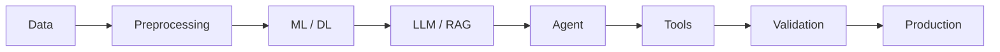
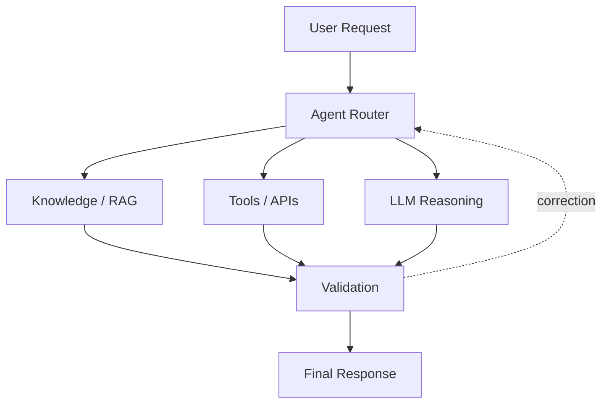

<!-- HEADER -->

Quick Navigation

About
I am a B.Tech Artificial Intelligence and Data Science student at GJUS&T interested in building practical AI systems that combine machine learning, modern LLMs and reliable software engineering.

My current path is:

Machine Learning → Deep Learning → Generative AI → RAG & LLM Applications → Agentic AI → AI Security → Production AI

I enjoy working across the complete AI application pipeline — from data and models to APIs, retrieval systems, agents, tools and user-facing applications.
Focus Areas
<table>
<tr>
<td width="25%" valign="top">

Machine Learning
Data preprocessing, feature engineering, supervised and unsupervised learning, model evaluation and practical data analysis.
</td>

<td width="25%" valign="top">

Deep Learning
Neural networks, NLP, sequence models, CNN concepts and model experimentation using TensorFlow and Keras.
</td>

<td width="25%" valign="top">

Generative AI
LLMs, prompt engineering, embeddings, RAG, LangChain, Hugging Face and LLM-powered applications.
</td>

<td width="25%" valign="top">

Agentic AI
LangGraph workflows, tool calling, routing, memory, validation and autonomous AI task execution.
</td>
</tr>
</table>

AI Security & Guardrails
Prompt Injection · Input Validation · Tool Permissions · Output Validation · Agent Safety
Tech Stack
<table>
<tr>
<td width="180"><b>Languages</b></td>
<td>Python · Java · C++ · SQL</td>
</tr>

<tr>
<td><b>AI / ML</b></td>
<td>TensorFlow · Keras · Scikit-learn · Pandas · NumPy · NLP · Computer Vision</td>
</tr>

<tr>
<td><b>Generative AI</b></td>
<td>LangChain · LangGraph · Groq · Hugging Face · RAG · LLMs · Embeddings</td>
</tr>

<tr>
<td><b>Backend</b></td>
<td>FastAPI · Flask · Streamlit · REST APIs</td>
</tr>

<tr>
<td><b>Databases</b></td>
<td>MySQL · SQLite · PostgreSQL · MongoDB · Pinecone</td>
</tr>

<tr>
<td><b>Tools</b></td>
<td>Git · GitHub · VS Code · Linux · Excel</td>
</tr>
</table>

Featured Projects
<table>
<tr>
<td width="50%" valign="top">

Medical Chatbot
RAG-based AI assistant

A medical knowledge assistant built with:
- LangChain
- Groq
- Hugging Face Embeddings
- Pinecone
- Flask
Uses document retrieval to provide responses grounded in a PDF knowledge base.

</td>

<td width="50%" valign="top">

Emotion Analyzer
Deep Learning NLP

Classifies six emotions:

Sadness · Joy · Love · Anger · Fear · Surprise

Compared SimpleRNN, LSTM, GRU and Bi-GRU.

Best result: Bi-GRU — ~91.7% test accuracy

FastAPI backend with an interactive emotion-analysis interface.
</td>
</tr>

<tr>
<td width="50%" valign="top">

CineSage
Movie Recommendation System

Content-based recommendation system using:
- TF-IDF
- Genre similarity
- Data preprocessing
- FastAPI
- Streamlit
Built around a large movie dataset and recommendation pipeline.
</td>

<td width="50%" valign="top">

TaskBot
AI-Powered Task Manager

AI task-management application using:
- LangChain
- Groq LLM
- SQLite
- Streamlit
Designed for natural-language task interaction and workflow automation.
</td>
</tr>

<tr>
<td width="50%" valign="top">

CropScan
Crop Health & Disease Detection

Hackathon project using deep learning and computer vision to analyze crop health and identify plant diseases.
</td>

<td width="50%" valign="top">

Explore More
More experiments and projects across AI, data science, backend development and LLM applications are available on GitHub.

</td>
</tr>
</table>

AI Architecture
From Data to Production AI

Agentic Workflow

Experience & Certifications
Internship — Mai Labs Pvt. Ltd.
Worked on an internship focused on Blockchain in Marketing, gaining exposure to industry-oriented technology and project workflows.
Code4Crew — Team Leader
Led the Code4Crew team during hackathon activities and worked on the CropScan project.
Certifications & Workshops
- Deloitte Australia — Data Analytics Job Simulation
- Hacknauts Certification
- SQL Workshop
- MS Excel Workshop
- Linux Workshop
- Web Essentials Workshop
- Cloud Computing / AWS Hands-on Workshop
- PRAGYAN Professional Development Workshop
Currently Exploring
<table>
<tr>
<td align="center"><b>LLMs</b> Model APIs · Prompt Engineering</td>
<td align="center"><b>RAG</b> Embeddings · Retrieval · Vector DBs</td>
<td align="center"><b>Agents</b> LangGraph · Tool Calling</td>
<td align="center"><b>Security</b> Guardrails · Safe Agents</td>
</tr>
</table>

GitHub Stats

Connect

<b>Building practical, intelligent and secure AI systems.</b>

