<!-- HEADER -->
<div align="center">


<a href="https://github.com/bhamniyaravi">
  
</a>

<br/><br/>

<a href="https://github.com/bhamniyaravi"></a>
<a href="https://www.linkedin.com/in/ravi-bhamniya-4aa4aa34a/"></a>
<a href="https://leetcode.com/u/bhamniyaravi8/"></a>
<a href="https://codeforces.com/profile/bhamniyaravi8/"></a>

<br/><br/>


</div>

<br/>

<div align="center">

<a href="#about-me"></a>
<a href="#the-ai-roadmap"></a>
<a href="#01--machine-learning"></a>
<a href="#02--deep-learning"></a>
<a href="#03--generative-ai"></a>
<a href="#04--agentic-ai"></a>
<a href="#05--ai-security--guardrails"></a>
<a href="#more-projects"></a>
<a href="#tech-stack"></a>
<a href="#competitive-programming"></a>
<a href="#github-statistics"></a>

</div>

---

## About Me

Hi, I'm **Ravi Bhamniya**, a B.Tech student specializing in **Artificial Intelligence and Data Science** at **Guru Jambheshwar University of Science and Technology (GJUS&T), Hisar**.

I am interested in building intelligent systems using **Machine Learning, Deep Learning, Generative AI, Agentic AI, RAG and Large Language Models**. My current focus is on building AI systems that are **reliable, secure, tool-aware, grounded and production-ready**, and on understanding how a prototype becomes a dependable real-world system.

<div align="center">

<table>
  <tr>
    <td align="center" width="20%"><h3>01</h3><sub>Machine Learning</sub></td>
    <td align="center" width="20%"><h3>02</h3><sub>Deep Learning</sub></td>
    <td align="center" width="20%"><h3>03</h3><sub>Generative AI</sub></td>
    <td align="center" width="20%"><h3>04</h3><sub>Agentic AI</sub></td>
    <td align="center" width="20%"><h3>05</h3><sub>AI Security and Guardrails</sub></td>
  </tr>
</table>

</div>

---

## The AI Roadmap

Each stage builds on the one before it. The sections below follow this path.

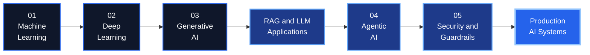

| Stage | What I work on | Representative project |
| :--- | :--- | :--- |
| **01 Machine Learning** | Data pipelines, classical algorithms, evaluation | CineSage |
| **02 Deep Learning** | Neural networks, NLP, computer vision | Emotion Analyzer, CropScan |
| **03 Generative AI** | LLMs, embeddings, vector search, RAG | Medical Chatbot |
| **04 Agentic AI** | Planning, tool calling, routing, multi-agent systems | TaskBot |
| **05 AI Security and Guardrails** | Validation, permissions, safe outputs | Current learning focus |

---

## 01 | Machine Learning

> Machine Learning is the foundation of my AI journey: data preparation, feature engineering, model training, evaluation and deployment.

### Workflow

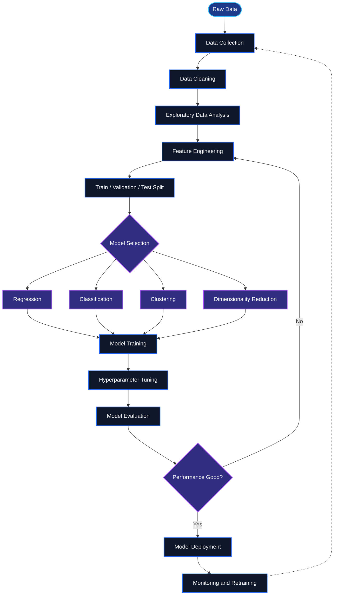

### Concept Map and Algorithms

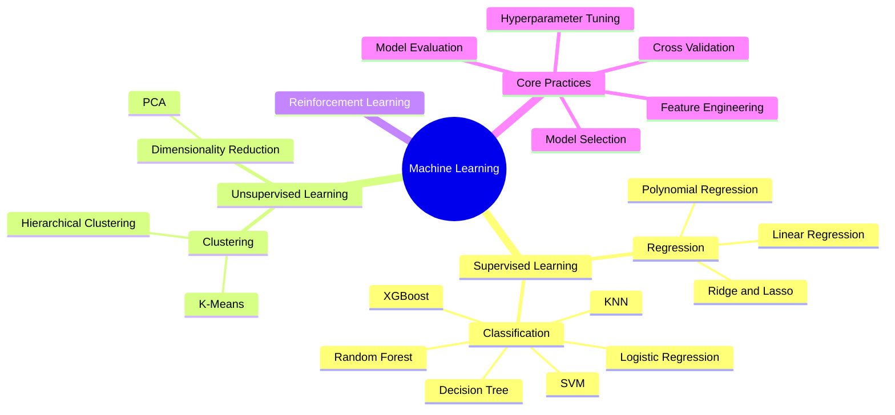

**Applied in:** CineSage, a content-based movie recommender built with TF-IDF (see [More Projects](#more-projects)).

---

## 02 | Deep Learning

> Deep Learning focuses on neural-network-based learning for NLP, computer vision, sequence modeling and complex pattern recognition.

### Training Workflow

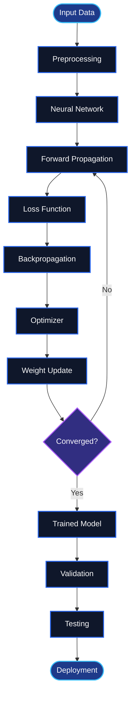

### Concept Map

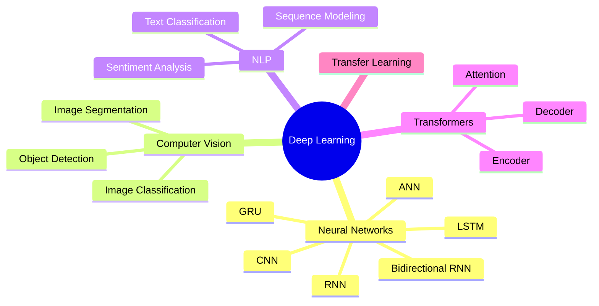

### Model Lifecycle

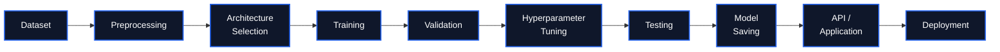

**Frameworks**


### Project: Emotion Analyzer

<sub>Python | Deep Learning | NLP | FastAPI | TensorFlow / Keras</sub>

An NLP and deep learning project that detects emotions from text and classifies it into six categories. I compared four sequence architectures, and the **Bidirectional GRU** performed best with approximately **91.70% test accuracy**. The app includes an interactive frontend called **Emotion Spectrometer**.

<div align="center">


</div>

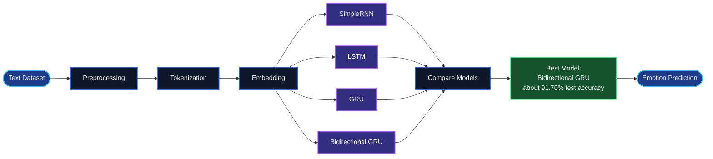

<a href="https://github.com/bhamniyaravi?tab=repositories"></a>

---

## 03 | Generative AI

> Generative AI is where I work with LLMs, embeddings, RAG, vector databases, structured outputs and AI applications.

### Workflow

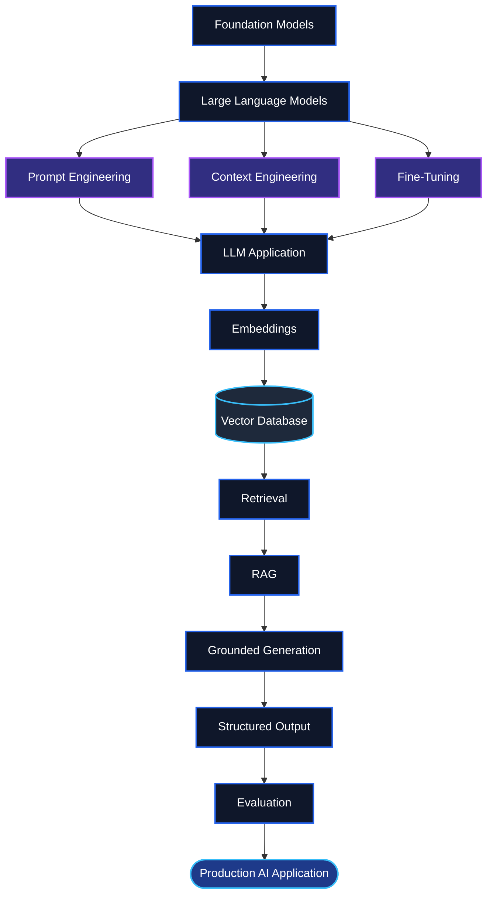

### Concept Map

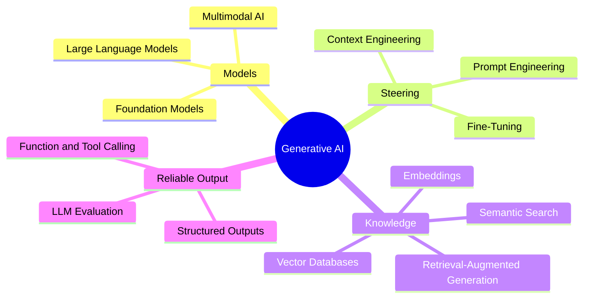

### RAG Architecture

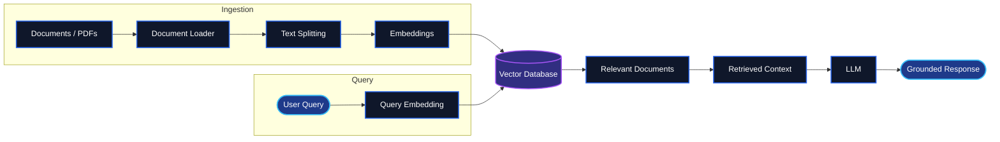

### Project: Medical Chatbot

<sub>Python | Flask | LangChain | Groq | Pinecone | Hugging Face Embeddings | RAG</sub>

A practical RAG implementation that answers questions from medical PDF documents. Rather than relying only on what an LLM has memorized, it retrieves the most relevant passages from an indexed knowledge base and gives them to the model as context, so answers are grounded in the source material.

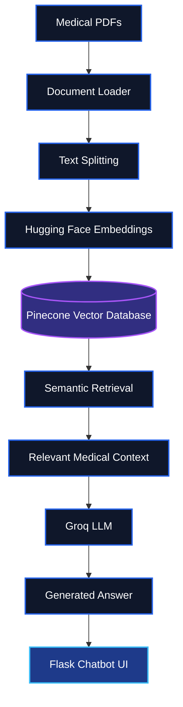

| Phase | What happens |
| :--- | :--- |
| Ingestion | PDFs are loaded, split into chunks, embedded and stored in Pinecone. |
| Retrieval | A question is matched against the index by semantic similarity. |
| Generation | Retrieved context is passed to the Groq LLM to produce a grounded answer. |
| Delivery | Answers are served through a Flask chatbot interface. |

<a href="https://github.com/bhamniyaravi/Medical-Chatbot"></a>

---

## 04 | Agentic AI

> Agentic AI focuses on systems that can understand goals, plan tasks, reason, use tools, maintain context, evaluate results and take controlled actions.

### Workflow

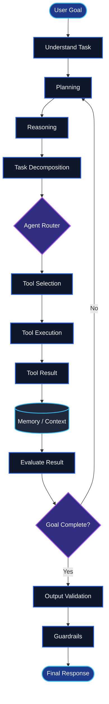

### Components

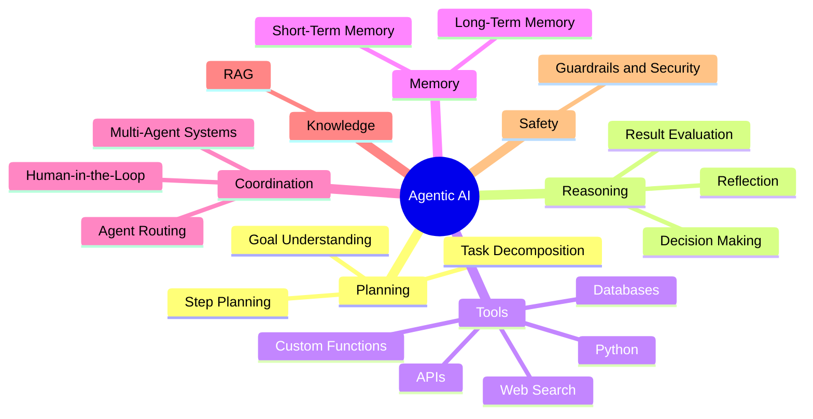

### Agent and Tools

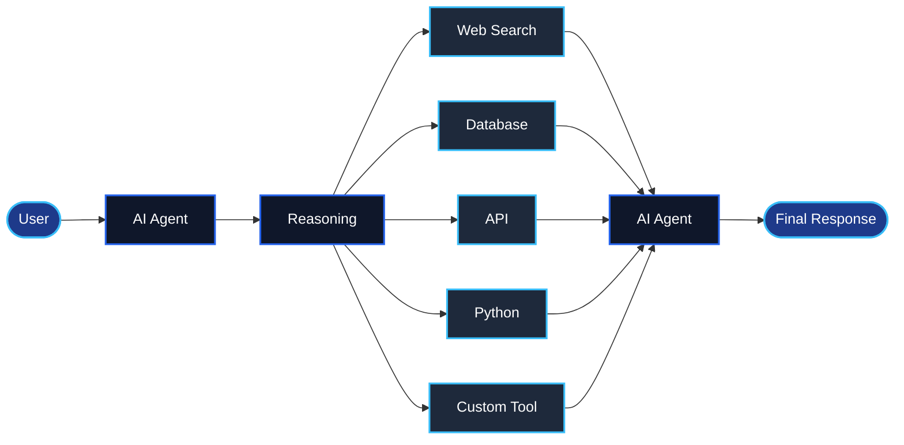

### Agent Routing

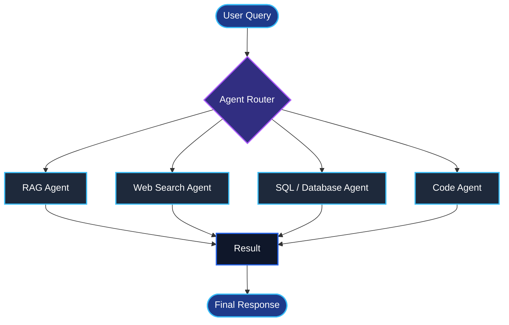

### Multi-Agent Architecture

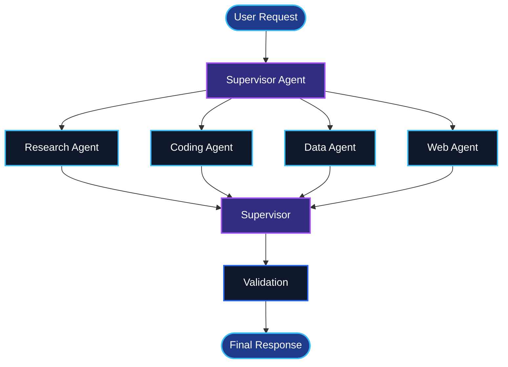

**Technologies**


### Project: TaskBot, AI Powered Task Manager

<sub>Python | LangChain | Groq | SQLite | Streamlit</sub>

An AI-powered task management project exploring how an LLM can interact with application functionality through tools and structured workflows. The user talks in natural language, and the model decides which function to execute against the database.

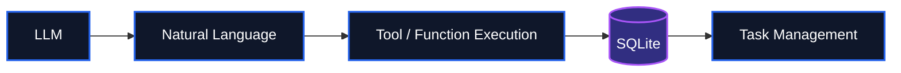

<a href="https://github.com/bhamniyaravi?tab=repositories"></a>

---

## 05 | AI Security & Guardrails

> AI security is a dedicated part of my learning focus, especially for LLM and agentic systems. I am studying how to keep autonomous systems controlled, grounded and safe.

### Secure Agentic AI Pipeline

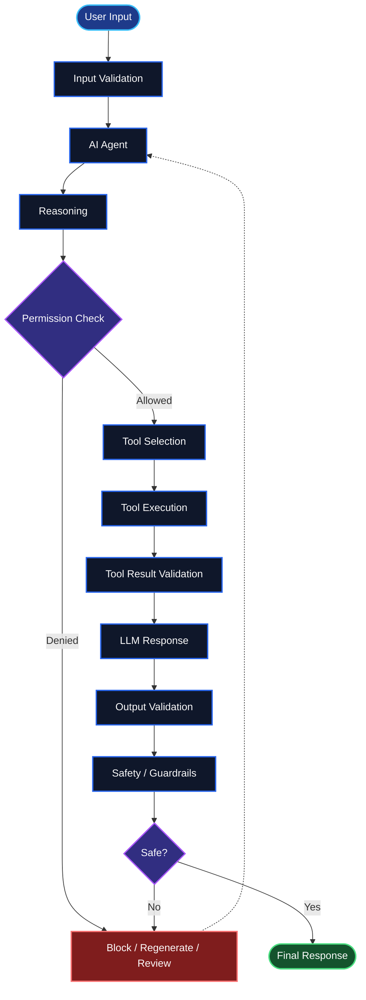

### Guardrails Mindset: Defense in Layers

Every request passes through checks before, during and after the agent acts.

```mermaid
flowchart LR
    subgraph BEFORE["Before the agent"]
        A[User Input] --> B[Input Validation]
    end
    subgraph DURING["While the agent acts"]
        C[Prompt / Agent] --> D[Permission Check]
        D --> E[Tool Calling]
        E --> F[Tool Result Validation]
    end
    subgraph AFTER["Before the user sees it"]
        G[LLM Response] --> H[Output Validation]
        H --> I[Safety Check]
    end
    B --> C
    F --> G
    I --> J([Final Response])

    classDef step fill:#0F172A,stroke:#2563EB,stroke-width:2px,color:#ffffff;
    classDef io fill:#1E3A8A,stroke:#38BDF8,stroke-width:2px,color:#ffffff;
    class A,B,C,D,E,F,G,H,I step;
    class J io;
```

### Security Areas

| Area | Focus |
| :--- | :--- |
| **Prompt Security** | Prompt injection and malicious instructions |
| **Input Validation** | Unsafe or unexpected inputs |
| **Output Validation** | Invalid or unsafe outputs |
| **Tool Security** | Restricting agent tools |
| **Permission Control** | Controlling agent actions |
| **PII Protection** | Sensitive information |
| **Hallucination Control** | Grounding responses |
| **RAG Security** | Untrusted retrieved content |
| **Agent Security** | Controlling autonomous behavior |
| **Evaluation** | Reliability and failure testing |

---

## More Projects

<table>
  <tr>
    <td width="50%" valign="top">
      <h3>CineSage</h3>
      <sub>Movie Recommendation System</sub>
      <p>A content-based movie recommendation system built using a dataset containing more than 45,000 films.</p>
      <ul>
        <li>Data cleaning and preprocessing</li>
        <li>TF-IDF based recommendation</li>
        <li>Genre-based recommendation and content similarity</li>
        <li>FastAPI backend with a Streamlit frontend</li>
      </ul>
      
      
      
      
      <br/><br/>
      <a href="https://github.com/bhamniyaravi?tab=repositories"></a>
    </td>
    <td width="50%" valign="top">
      <h3>CropScan</h3>
      <sub>Hackathon Project</sub>
      <p>A hackathon project focused on crop health and disease detection using deep learning and computer vision concepts.</p>
      <ul>
        <li>Deep learning for image-based classification</li>
        <li>Computer vision applied to agriculture</li>
      </ul>
      
      
      
      <br/><br/>
      <a href="https://github.com/bhamniyaravi?tab=repositories"></a>
    </td>
  </tr>
</table>

---

## Tech Stack

<table>
  <tr>
    <td width="200"><b>Programming Languages</b></td>
    <td>
      
      
    </td>
  </tr>
  <tr>
    <td><b>AI / Machine Learning</b></td>
    <td>
      
      
      
      
      
      
      
      <br/>
      
      
    </td>
  </tr>
  <tr>
    <td><b>Generative AI and LLM</b></td>
    <td>
      
      
      
      
      
      
      
      <br/>
      
      
      
      
    </td>
  </tr>
  <tr>
    <td><b>Databases</b></td>
    <td>
      
      
    </td>
  </tr>
  <tr>
    <td><b>Frameworks and Tools</b></td>
    <td>
      
      
      
      
    </td>
  </tr>
</table>

---

## Competitive Programming

I practice Data Structures and Algorithms and problem solving.

<a href="https://leetcode.com/u/bhamniyaravi8/"></a>
<a href="https://codeforces.com/profile/bhamniyaravi8/"></a>

**Current DSA focus**

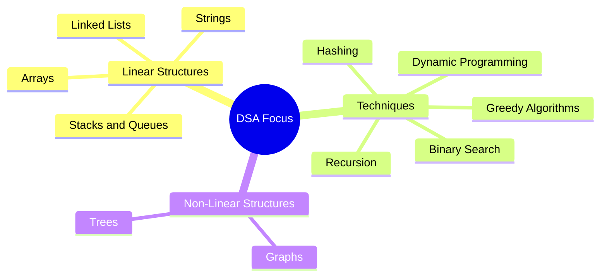

---

## GitHub Statistics

<div align="center">


<br/>


<br/>


</div>

---

## Experience and Activities

<table>
  <tr>
    <td valign="top">
      <b>Team Leader, Code4Crew</b><br/>
      <sub>NexHack Hackathon 2025</sub>
      <ul>
        <li>Participated in NexHack Hackathon 2025 as the team leader of Code4Crew, working collaboratively on an AI-focused project.</li>
      </ul>
    </td>
  </tr>
</table>

**Workshops and learning:** SQL, Microsoft Excel, Linux, Web Development, Cloud Computing, AWS, Data Analytics, Professional Development.

### Certifications and Learning

| Program | Area |
| :--- | :--- |
| **Deloitte Australia** | Data Analytics Job Simulation |
| **SQL Workshop** | Databases and querying |
| **MS Excel Workshop** | Spreadsheets and data handling |
| **Linux Workshop** | Command line and systems |
| **Web Essentials Workshop** | Web development fundamentals |
| **Cloud Computing / AWS Workshop** | Cloud fundamentals |
| **Professional Development Workshop** | Professional skills |

---

## Currently Exploring

```mermaid
flowchart LR
    A[Agentic AI] --> B[LangGraph]
    B --> C[Multi-Agent<br/>Systems]
    C --> D[Tool<br/>Calling]
    D --> E[RAG]
    E --> F[LLM<br/>Evaluation]
    F --> G[AI<br/>Security]
    G --> H[Guardrails]
    H --> I[Production<br/>AI Systems]

    classDef step fill:#0F172A,stroke:#2563EB,stroke-width:2px,color:#ffffff;
    classDef goal fill:#2563EB,stroke:#93C5FD,stroke-width:3px,color:#ffffff;
    class A,B,C,D,E,F,G,H step;
    class I goal;
```

I am focused on building AI applications that are:

<div align="center">


</div>

---

## My Development Philosophy

```mermaid
flowchart LR
    A[Build] --> B[Break] --> C[Debug] --> D[Learn] --> E[Improve] --> F[Repeat]
    F -.-> A

    classDef step fill:#0F172A,stroke:#2563EB,stroke-width:2px,color:#ffffff;
    class A,B,C,D,E,F step;
```

> I believe the best way to learn AI is by building real systems, understanding why they fail, and continuously improving them.

---

## Let's Connect

<div align="center">

<a href="https://github.com/bhamniyaravi"></a>
<a href="https://www.linkedin.com/in/ravi-bhamniya-4aa4aa34a/"></a>
<a href="https://leetcode.com/u/bhamniyaravi8/"></a>
<a href="https://codeforces.com/profile/bhamniyaravi8/"></a>

<br/><br/>

<b>AI & Data Science | Machine Learning | Deep Learning | Generative AI | Agentic AI | AI Security</b>


</div>
