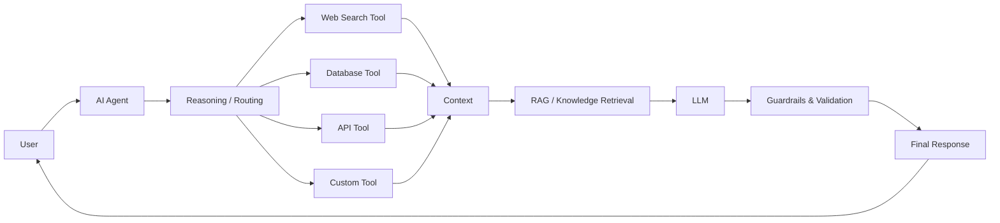

Ravi Bhamniya

  

  <a href="https://github.com/bhamniyaravi">GitHub</a> ·
  <a href="https://www.linkedin.com/in/ravi-bhamniya-4aa4aa34a/">LinkedIn</a> ·
  <a href="https://leetcode.com/u/bhamniyaravi8/">LeetCode</a> ·
  <a href="https://codeforces.com/profile/bhamniyaravi8">Codeforces</a>

  

About Me
Hi, I'm Ravi Bhamniya, a B.Tech student specializing in Artificial Intelligence and Data Science.
I am interested in building intelligent systems using Generative AI, Agentic AI, Machine Learning, Deep Learning, RAG, and Large Language Models.
My current focus is on building AI systems that are reliable, secure, tool-aware, grounded, and production-ready.
What I Work On
Generative AI
- Large Language Models
- Prompt Engineering
- Retrieval-Augmented Generation
- Embeddings and Vector Databases
- Semantic Search
- Structured Outputs
- LLM APIs
- AI-powered applications
Agentic AI
- AI Agents
- LangChain
- LangGraph
- Tool Calling
- Agent Routing
- Stateful Workflows
- Memory and Context
- Multi-Agent Systems
- Human-in-the-Loop workflows
AI Security & Guardrails
- Prompt injection defense
- Input and output validation
- Tool permission control
- Structured responses
- PII protection
- Hallucination reduction
- Content safety
- Agent behavior constraints
- LLM evaluation
- Secure tool calling
Agentic AI Architecture

Tech Stack
Programming Languages
Python · Java · C++ · C · JavaScript · HTML · CSS · SQL
AI / Machine Learning
Machine Learning · Deep Learning · NLP · Computer Vision · Neural Networks · Model Evaluation · Data Preprocessing
Generative AI & LLM
LangChain · LangGraph · Groq · Hugging Face · Google GenAI · Mistral · RAG · Sentence Transformers · Vector Search · Tool Calling · Structured Output
Databases
MySQL · PostgreSQL · MongoDB · SQLite · Pinecone
Frameworks & Tools
Flask · FastAPI · Streamlit · Git · GitHub · VS Code · Linux · Jupyter · Docker · REST APIs
Featured Projects
Medical Chatbot — RAG Based AI Application
Tech: Python · Flask · LangChain · Groq · Pinecone · Hugging Face Embeddings · RAG
A medical knowledge assistant built using a Retrieval-Augmented Generation architecture.
- PDF-based knowledge retrieval
- Document chunking
- Semantic embeddings
- Vector similarity search
- Pinecone vector database
- LLM-powered response generation
- Flask web interface
View Project
Emotion Analyzer
Tech: Python · Deep Learning · NLP · FastAPI · TensorFlow/Keras
An NLP-based emotion classification system for six emotions:
Sadness · Joy · Love · Anger · Fear · Surprise
Compared SimpleRNN, LSTM, GRU, and Bidirectional GRU architectures. The Bidirectional GRU model achieved approximately 91.70% test accuracy.
CineSage — Movie Recommendation System
Tech: Python · FastAPI · Streamlit · TF-IDF · Machine Learning
A content-based movie recommendation system built using a dataset containing more than 45,000 films.
- Data cleaning and preprocessing
- TF-IDF based recommendation
- Genre-based recommendation
- Content similarity
- FastAPI backend
- Streamlit frontend
TaskBot — AI Powered Task Manager
Tech: Python · LangChain · Groq · SQLite · Streamlit
An AI-powered task management project exploring LLM interaction with application functionality through tools and structured workflows.
LLM
 ↓
Natural Language
 ↓
Tool / Function Execution
 ↓
SQLite
 ↓
Task Management
CropScan
Tech: Python · Deep Learning · Computer Vision
A hackathon project focused on crop health and disease detection using deep learning and computer vision concepts.
AI Engineering Workflow
Problem
   ↓
Data Collection
   ↓
Data Cleaning
   ↓
Model / LLM Selection
   ↓
Prompt / Pipeline Design
   ↓
RAG / Tools / Agents
   ↓
Evaluation
   ↓
Security & Guardrails
   ↓
API / Application
   ↓
Deployment
AI Security & Guardrails
Area	Focus
Prompt Security	Prompt injection and malicious instructions
Input Validation	Controlling unsafe or unexpected inputs
Output Validation	Ensuring responses follow expected formats
Tool Security	Restricting what agents can execute
PII Protection	Preventing sensitive information exposure
Hallucination Control	Grounding responses using trusted context
Content Safety	Filtering inappropriate or unsafe outputs
Agent Control	Limiting autonomous behavior
Evaluation	Testing reliability and failure cases

Security Mindset
User Input
    ↓
Input Validation
    ↓
Prompt / Agent
    ↓
Tool Permission Check
    ↓
RAG / External Data
    ↓
LLM
    ↓
Output Validation
    ↓
Safety Check
    ↓
Final Response
Competitive Programming
I practice Data Structures & Algorithms and problem solving.
- LeetCode
- Codeforces
Current DSA Focus
Arrays · Strings · Linked Lists · Stacks & Queues · Hashing · Recursion · Binary Search · Trees · Graphs · Greedy Algorithms · Dynamic Programming
GitHub Statistics

  
  

  

Experience & Activities
Code4Crew — Team Leader
Participated in NexHack Hackathon 2025 as the team leader of Code4Crew, working collaboratively on an AI-focused project.
Workshops & Learning
SQL · Microsoft Excel · Linux · Web Development · Cloud Computing · AWS · Data Analytics · Professional Development
Certifications & Learning
- Deloitte Australia — Data Analytics Job Simulation
- SQL Workshop
- MS Excel Workshop
- Linux Workshop
- Web Essentials Workshop
- Cloud Computing / AWS Workshop
- Professional Development Workshop
Currently Exploring
Agentic AI → LangGraph → Multi-Agent Systems → Tool Calling → RAG → LLM Evaluation → AI Security → Guardrails → Production AI Systems
I am focused on building AI applications that are:
Reliable · Secure · Grounded · Tool-Aware · Scalable
My Development Philosophy
Build → Break → Debug → Learn → Improve → Repeat

I believe the best way to learn AI is by building real systems, understanding why they fail, and continuously improving them.
Let's Connect

  <a href="https://github.com/bhamniyaravi">GitHub</a> ·
  <a href="https://www.linkedin.com/in/ravi-bhamniya-4aa4aa34a/">LinkedIn</a> ·
  <a href="https://leetcode.com/u/bhamniyaravi8/">LeetCode</a> ·
  <a href="https://codeforces.com/profile/bhamniyaravi8">Codeforces</a>

  

  <b>AI & Data Science | Generative AI | Agentic AI | AI Security</b>

