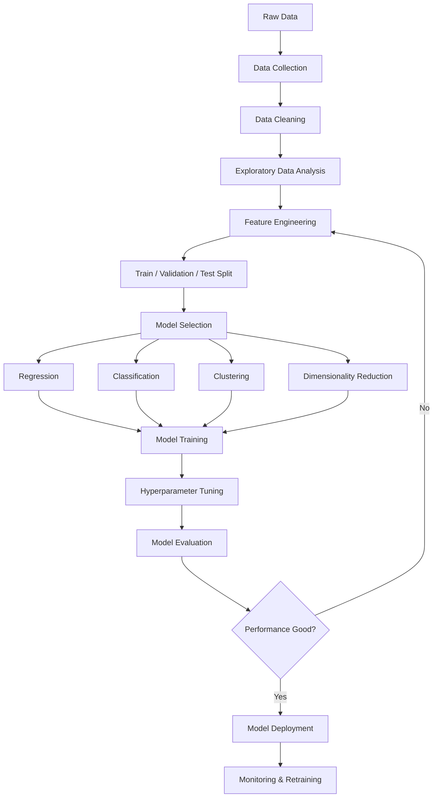
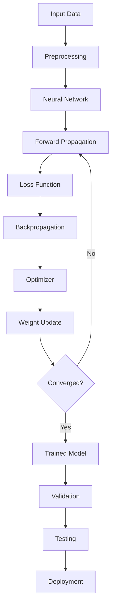
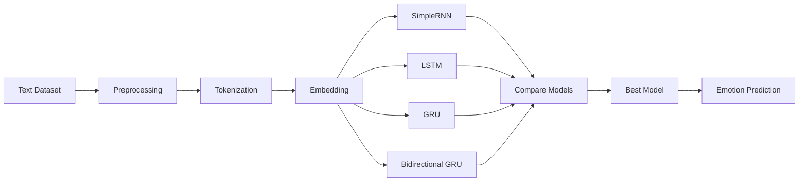
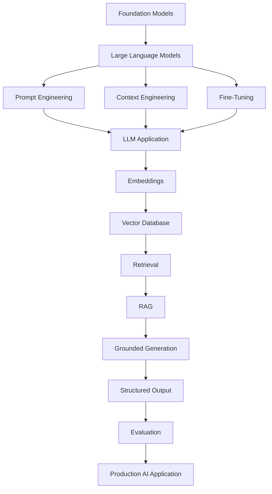
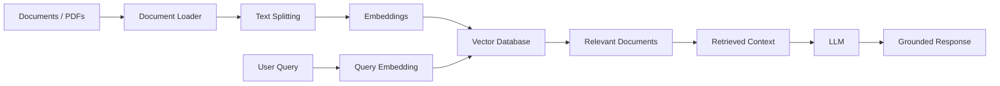
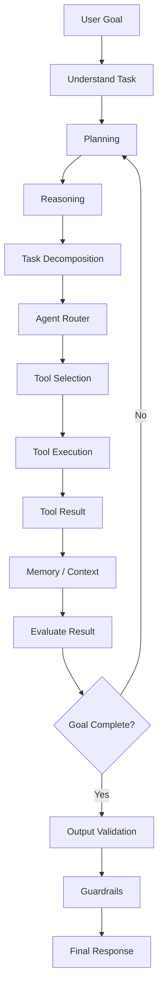
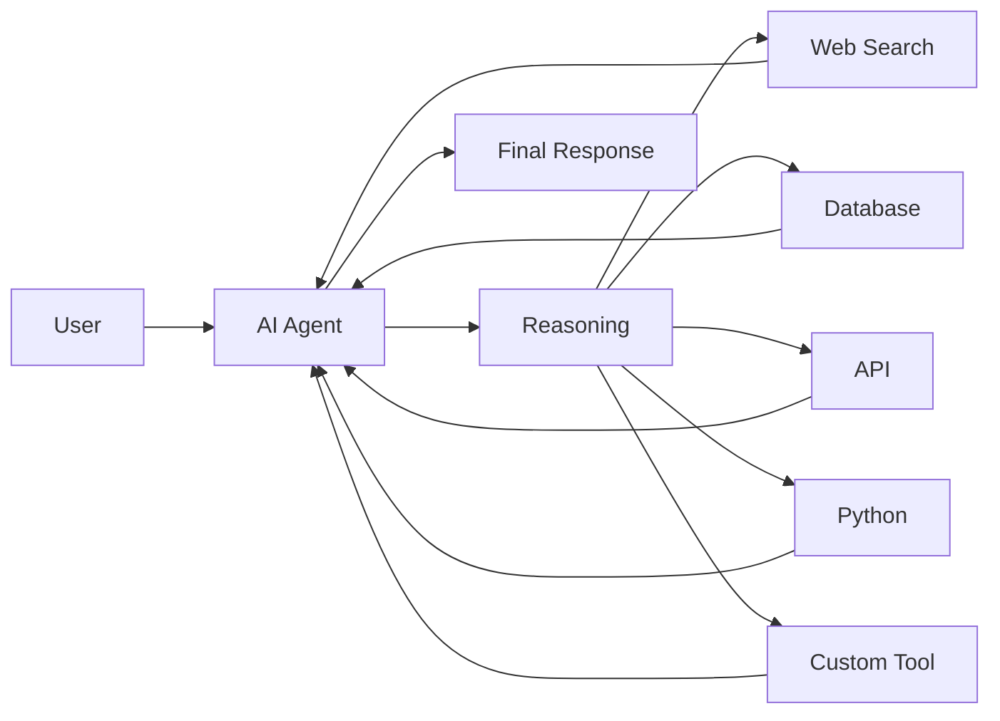
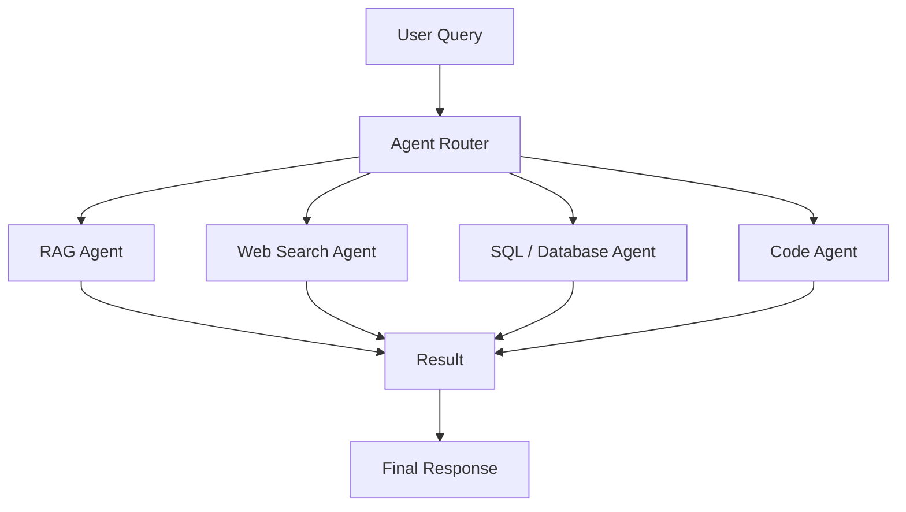
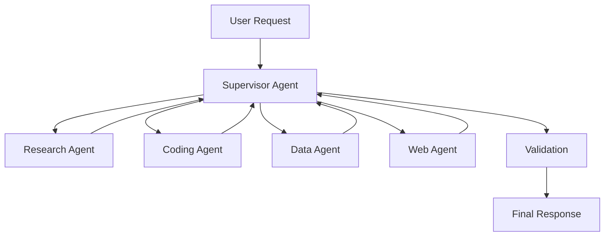
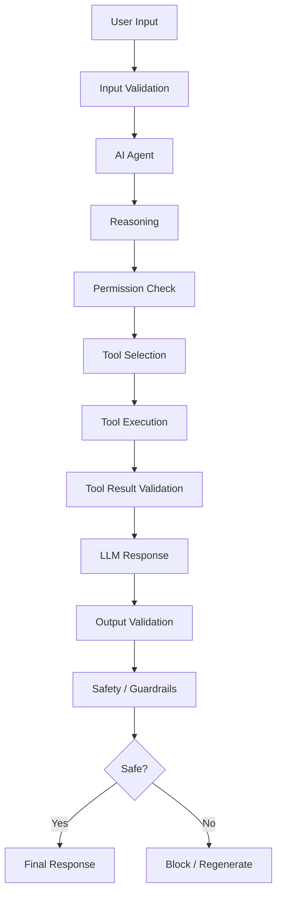

Ravi Bhamniya

  

  <a href="https://github.com/bhamniyaravi">GitHub</a> ·
  <a href="https://www.linkedin.com/in/ravi-bhamniya-4aa4aa34a/">LinkedIn</a> ·
  <a href="https://leetcode.com/u/bhamniyaravi8/">LeetCode</a> ·
  <a href="https://codeforces.com/profile/bhamniyaravi8">Codeforces</a>

  

About Me
Hi, I'm Ravi Bhamniya, a B.Tech student specializing in Artificial Intelligence and Data Science.
I am interested in building intelligent systems using Machine Learning, Deep Learning, Generative AI, Agentic AI, RAG, and Large Language Models.
My current focus is on building AI systems that are reliable, secure, tool-aware, grounded, and production-ready.
Machine Learning
Machine Learning is the foundation of my AI journey, covering data preparation, feature engineering, model training, evaluation, and deployment.
ML Workflow

ML Concepts
Machine Learning
│
├── Supervised Learning
│   ├── Regression
│   └── Classification
│
├── Unsupervised Learning
│   ├── Clustering
│   └── Dimensionality Reduction
│
├── Reinforcement Learning
│
├── Feature Engineering
├── Model Selection
├── Cross Validation
├── Hyperparameter Tuning
└── Model Evaluation
Algorithms
Regression
├── Linear Regression
├── Polynomial Regression
└── Ridge / Lasso

Classification
├── Logistic Regression
├── Decision Tree
├── Random Forest
├── SVM
├── KNN
└── XGBoost

Unsupervised Learning
├── K-Means
├── Hierarchical Clustering
└── PCA
Deep Learning
Deep Learning focuses on neural-network-based learning for NLP, computer vision, sequence modeling, and complex pattern recognition.
DL Workflow

Deep Learning Structure
Deep Learning
│
├── Neural Networks
│   ├── ANN
│   ├── CNN
│   ├── RNN
│   ├── LSTM
│   └── GRU
│
├── Computer Vision
│   ├── Image Classification
│   ├── Object Detection
│   └── Image Segmentation
│
├── NLP
│   ├── Text Classification
│   ├── Sentiment Analysis
│   └── Sequence Modeling
│
├── Transformers
│   ├── Attention
│   ├── Encoder
│   └── Decoder
│
└── Transfer Learning
Deep Learning Model Lifecycle
Dataset
   ↓
Preprocessing
   ↓
Architecture Selection
   ↓
Training
   ↓
Validation
   ↓
Hyperparameter Tuning
   ↓
Testing
   ↓
Model Saving
   ↓
API / Application
   ↓
Deployment
Emotion Analyzer
Tech: Python · Deep Learning · NLP · FastAPI · TensorFlow/Keras

The project classifies:
Sadness · Joy · Love · Anger · Fear · Surprise
The Bidirectional GRU model achieved approximately 91.70% test accuracy.
Generative AI
Generative AI is where I work with LLMs, embeddings, RAG, vector databases, structured outputs, and AI applications.
GenAI Workflow

Generative AI Structure
Generative AI
│
├── Foundation Models
├── Large Language Models
├── Prompt Engineering
├── Context Engineering
├── Embeddings
├── Vector Databases
├── Semantic Search
├── Retrieval-Augmented Generation
├── Fine-Tuning
├── Structured Outputs
├── Function / Tool Calling
├── Multimodal AI
└── LLM Evaluation
RAG Architecture

Medical Chatbot
Tech: Python · Flask · LangChain · Groq · Pinecone · Hugging Face Embeddings · RAG
Medical PDFs
     ↓
Document Loader
     ↓
Text Splitting
     ↓
Hugging Face Embeddings
     ↓
Pinecone Vector Database
     ↓
Semantic Retrieval
     ↓
Relevant Medical Context
     ↓
Groq LLM
     ↓
Generated Answer
     ↓
Flask Chatbot UI
View Medical Chatbot
Agentic AI
Agentic AI focuses on systems that can understand goals, plan tasks, reason, use tools, maintain context, evaluate results, and take controlled actions.
Agentic AI Workflow

Agentic AI Components
Agentic AI
│
├── Agent
│
├── Planning
│   ├── Goal Understanding
│   ├── Task Decomposition
│   └── Step Planning
│
├── Reasoning
│   ├── Decision Making
│   ├── Reflection
│   └── Result Evaluation
│
├── Tools
│   ├── Web Search
│   ├── APIs
│   ├── Databases
│   ├── Python
│   └── Custom Functions
│
├── Memory
│   ├── Short-Term Memory
│   └── Long-Term Memory
│
├── RAG
├── Agent Routing
├── Multi-Agent Systems
├── Human-in-the-Loop
└── Guardrails & Security
Agent + Tools

Agent Routing

Multi-Agent Architecture

AI Security & Guardrails
AI security is a dedicated part of my learning focus, especially for LLM and agentic systems.
Secure Agentic AI Pipeline

Security Areas
Area	Focus
Prompt Security	Prompt injection and malicious instructions
Input Validation	Unsafe or unexpected inputs
Output Validation	Invalid or unsafe outputs
Tool Security	Restricting agent tools
Permission Control	Controlling agent actions
PII Protection	Sensitive information
Hallucination Control	Grounding responses
RAG Security	Untrusted retrieved content
Agent Security	Controlling autonomous behavior
Evaluation	Reliability and failure testing

Guardrails Mindset
User Input
    ↓
Input Validation
    ↓
Prompt / Agent
    ↓
Permission Check
    ↓
Tool Calling
    ↓
Tool Result Validation
    ↓
LLM Response
    ↓
Output Validation
    ↓
Safety Check
    ↓
Final Response
Tech Stack
Programming Languages
Python · Java · C++ · C · JavaScript · HTML · CSS · SQL
AI / Machine Learning
Machine Learning · Deep Learning · NLP · Computer Vision · Neural Networks · Model Evaluation · Data Preprocessing
Generative AI & LLM
LangChain · LangGraph · Groq · Hugging Face · Google GenAI · Mistral · RAG · Sentence Transformers · Vector Search · Tool Calling · Structured Output
Databases
MySQL · PostgreSQL · MongoDB · SQLite · Pinecone
Frameworks & Tools
Flask · FastAPI · Streamlit · Git · GitHub · VS Code · Linux · Jupyter · Docker · REST APIs
Featured Projects
CineSage — Movie Recommendation System
Tech: Python · FastAPI · Streamlit · TF-IDF · Machine Learning
A content-based movie recommendation system built using a dataset containing more than 45,000 films.
- Data cleaning and preprocessing
- TF-IDF based recommendation
- Genre-based recommendation
- Content similarity
- FastAPI backend
- Streamlit frontend
TaskBot — AI Powered Task Manager
Tech: Python · LangChain · Groq · SQLite · Streamlit
An AI-powered task management project exploring LLM interaction with application functionality through tools and structured workflows.
LLM
 ↓
Natural Language
 ↓
Tool / Function Execution
 ↓
SQLite
 ↓
Task Management
CropScan
Tech: Python · Deep Learning · Computer Vision
A hackathon project focused on crop health and disease detection using deep learning and computer vision concepts.
Competitive Programming
I practice Data Structures & Algorithms and problem solving.
- LeetCode
- Codeforces
Current DSA Focus
Arrays · Strings · Linked Lists · Stacks & Queues · Hashing · Recursion · Binary Search · Trees · Graphs · Greedy Algorithms · Dynamic Programming
GitHub Statistics

  
  

  

Experience & Activities
Code4Crew — Team Leader
Participated in NexHack Hackathon 2025 as the team leader of Code4Crew, working collaboratively on an AI-focused project.
Workshops & Learning
SQL · Microsoft Excel · Linux · Web Development · Cloud Computing · AWS · Data Analytics · Professional Development
Certifications & Learning
- Deloitte Australia — Data Analytics Job Simulation
- SQL Workshop
- MS Excel Workshop
- Linux Workshop
- Web Essentials Workshop
- Cloud Computing / AWS Workshop
- Professional Development Workshop
Currently Exploring
Agentic AI
      ↓
LangGraph
      ↓
Multi-Agent Systems
      ↓
Tool Calling
      ↓
RAG
      ↓
LLM Evaluation
      ↓
AI Security
      ↓
Guardrails
      ↓
Production AI Systems
I am focused on building AI applications that are:
Reliable · Secure · Grounded · Tool-Aware · Scalable
My Development Philosophy
Build → Break → Debug → Learn → Improve → Repeat

I believe the best way to learn AI is by building real systems, understanding why they fail, and continuously improving them.
Let's Connect

  <a href="https://github.com/bhamniyaravi">GitHub</a> ·
  <a href="https://www.linkedin.com/in/ravi-bhamniya-4aa4aa34a/">LinkedIn</a> ·
  <a href="https://leetcode.com/u/bhamniyaravi8/">LeetCode</a> ·
  <a href="https://codeforces.com/profile/bhamniyaravi8">Codeforces</a>

  

  <b>AI & Data Science | Machine Learning | Deep Learning | Generative AI | Agentic AI | AI Security</b>

