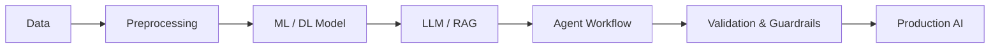
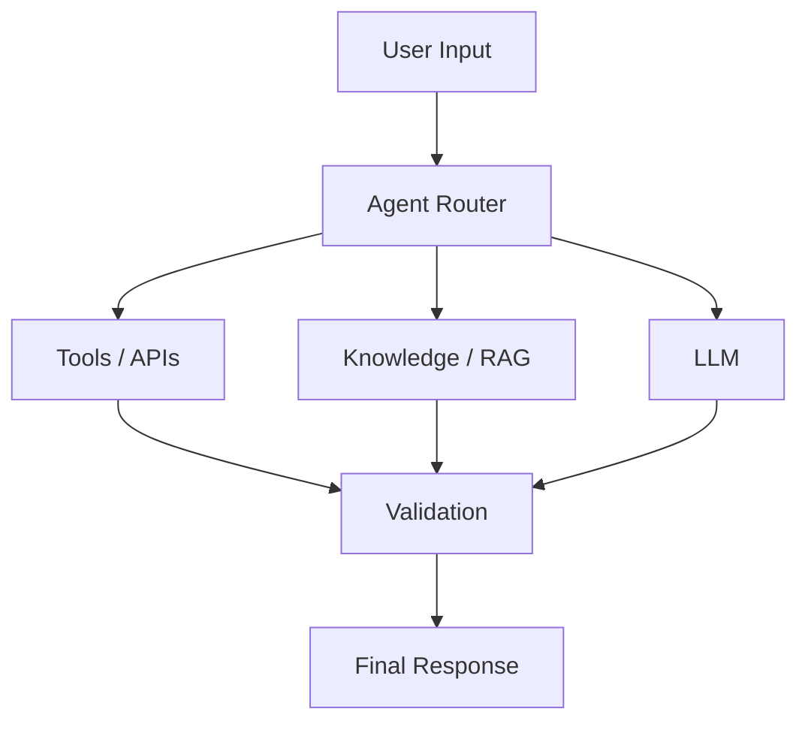

<!-- HEADER -->

Quick Navigation

About
B.Tech student in Artificial Intelligence and Data Science at GJUS&T, focused on building practical AI applications.

My interests span Machine Learning, Deep Learning, Generative AI, RAG, LLM applications, Agentic AI and AI Security. I enjoy turning AI concepts into usable systems with Python, APIs, databases and modern AI frameworks.
Focus Areas
<table>
<tr>
<td width="25%" valign="top">

Machine Learning
Supervised and unsupervised learning, data analysis, feature engineering and model evaluation.
</td>
<td width="25%" valign="top">

Deep Learning
Neural networks, NLP, sequence models, CNNs and practical model development.
</td>
<td width="25%" valign="top">

Generative AI
LLMs, prompt engineering, embeddings, RAG, LangChain and LLM-powered applications.
</td>
<td width="25%" valign="top">

Agentic AI
LangGraph workflows, tool calling, routing, memory, validation and AI automation.
</td>
</tr>
</table>

AI Security
Prompt Injection • Input Validation • Tool Security • Output Guardrails • Agent Safety
Tech Stack
<table>
<tr>
<td width="180"><b>Languages</b></td>
<td>

</td>
</tr>

<tr>
<td><b>AI / ML</b></td>
<td>

&nbsp; Scikit-learn • NLP • Computer Vision • Pandas • NumPy
</td>
</tr>

<tr>
<td><b>Generative AI</b></td>
<td>
LangChain • LangGraph • Groq • Hugging Face • RAG • LLMs
</td>
</tr>

<tr>
<td><b>Backend</b></td>
<td>

</td>
</tr>

<tr>
<td><b>Databases</b></td>
<td>

&nbsp; Pinecone
</td>
</tr>

<tr>
<td><b>Tools</b></td>
<td>

&nbsp; Excel
</td>
</tr>
</table>

Projects
<table>
<tr>
<td width="50%" valign="top">

Medical Chatbot
RAG-based medical assistant using:
- LangChain
- Groq LLM
- Hugging Face Embeddings
- Pinecone
- Flask
Retrieves relevant information from a PDF knowledge base before generating responses.

</td>

<td width="50%" valign="top">

Emotion Analyzer
Deep-learning NLP system that classifies six emotions:

Sadness Joy Love Anger Fear Surprise

Compared:

SimpleRNN • LSTM • GRU • Bi-GRU

Best model: Bi-GRU with approximately 91.7% test accuracy.
</td>
</tr>

<tr>
<td width="50%" valign="top">

CineSage
Content-based movie recommendation system using:
- TF-IDF
- Genre similarity
- FastAPI
- Streamlit
- Data preprocessing
Built around a large movie dataset and recommendation pipeline.
</td>

<td width="50%" valign="top">

TaskBot
AI-powered task manager using:
- LangChain
- Groq LLM
- SQLite
- Streamlit
Designed for natural-language interaction with task-management workflows.
</td>
</tr>

<tr>
<td width="50%" valign="top">

CropScan
Hackathon project focused on crop health and disease detection using deep learning and computer vision.
</td>

<td width="50%" valign="top">

More Projects
Explore my GitHub for additional AI, data science, backend and development projects.

</td>
</tr>
</table>

AI Workflow
From Data to AI Application

Agentic AI

Experience
Internship — Mai Labs Pvt. Ltd.
Worked in the area of Blockchain in Marketing, gaining exposure to industry-oriented technology and project workflows.
Code4Crew — Team Leader
Led the Code4Crew team during hackathon/project activities, working on CropScan and collaborative AI development.
Certifications & Workshops
- Deloitte Australia — Data Analytics Job Simulation
- Hacknauts Certification
- SQL Workshop
- MS Excel Workshop
- Linux Workshop
- Web Essentials Workshop
- Cloud Computing / AWS Hands-on Workshop
- PRAGYAN Professional Development Workshop
Currently Exploring
Agentic AI • RAG • LangGraph • LLM Applications • AI Security • Production AI
Stats

Connect

<b>Building practical, intelligent and secure AI systems.</b>

